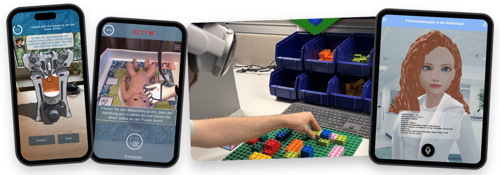
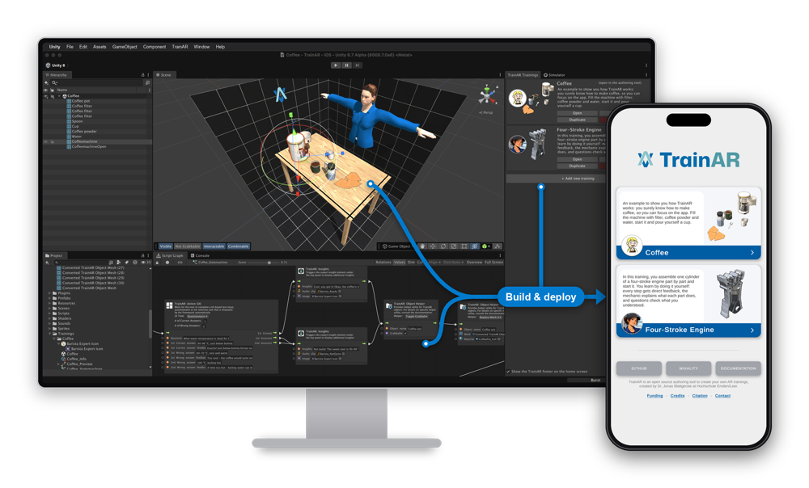
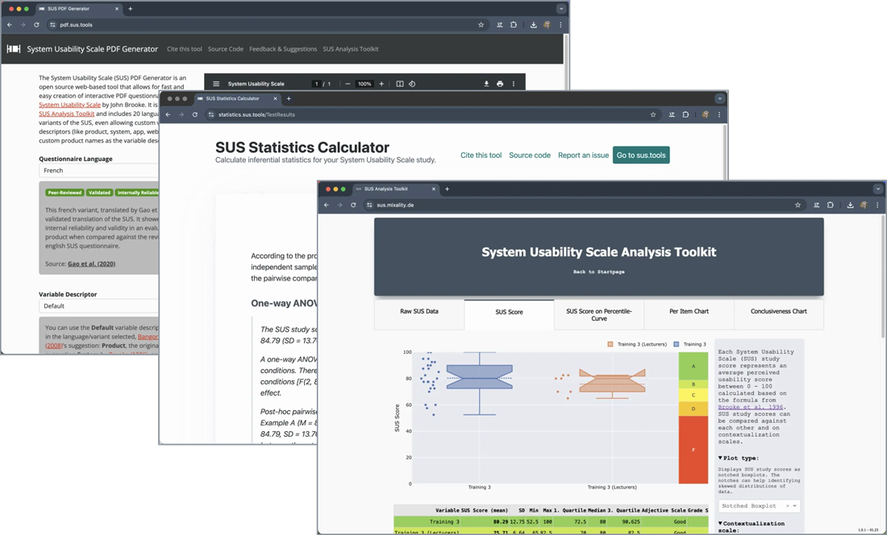

<h2 align="center">Moin! I'm Jonas and I work on EdTech & XR :man_technologist:</h2>

  
  
  
  
  
  

I am an Augmented & Mixed Reality developer and Human-Computer Interaction researcher, currently working as a Postdoctoral Researcher at the [Mixality Lab](https://mixality.de/) of the [University of Applied Sciences Emden/Leer](https://www.hs-emden-leer.de/). My research focuses on Mixed Reality assistance & training, AI-enabled educational technology and interaction design for authoring tools in these contexts. I am passionate about Open Source, Open Science and Open Educational Resources, so I try to share as much as possible here.

### :telescope: Currently working on

- :eu: **[EDARA](https://mixality.de/edara/)** (Erasmus+, 2026–2029): As one of the Principal Investigators, I research how educators in higher education can create AR trainings with AI support.
- :school: **[NORDIB](https://mixality.de/nordib/)** (zukunft.niedersachsen, 2025–2030): In this educational technology initiative, I work on mixed reality authoring tools for education, from authoring by demonstration, where AI models extract procedural knowledge from a single demonstration, to authoring tools for anthropomorphic AI avatars (see, for example, [VisAARD](https://github.com/jblattgerste/VisAARD) and [AvaKIT](https://mixality.de/nordib/)).

### :hammer_and_wrench: Selected open-source projects

<table>
  <tr>
    <td width="50%" valign="top">
       
      <b><a href="https://github.com/jblattgerste/TrainAR">TrainAR</a></b>  
      An interaction concept, didactic framework and visual scripting-based authoring tool for procedural AR trainings on Android & iOS, evaluated with more than 50 authors and more than 350 learners. 
       📄 <a href="https://doi.org/10.3390/mti5070030">Interaction Concept & Didactics (MTI 2021)</a>
       📄 <a href="https://doi.org/10.3390/info14040219">Authoring Tool (Information 2023)</a>
       📖 <a href="https://jblattgerste.github.io/TrainAR/">Documentation</a>&emsp;▶️ <a href="https://www.youtube.com/watch?v=OjIrRynK67o">Video</a>
    </td>
    <td width="50%" valign="top">
       
      <b><a href="https://sus.tools">SUS.tools</a></b>  
      Free tools that make the System Usability Scale more approachable: analysis and charts of SUS scores, inferential statistics in the browser, and PDF questionnaires in 20 languages and variants. 
       📊 <a href="https://github.com/jblattgerste/sus-analysis-toolkit">Analysis Toolkit</a>&emsp;🧮 <a href="https://github.com/jblattgerste/sus-statistics-calculator">Statistics Calculator</a>
       📝 <a href="https://github.com/jblattgerste/sus-pdf-generator">PDF Generator</a>&emsp;📄 <a href="https://doi.org/10.1145/3529190.3529216">Paper (PETRA 2022)</a>
    </td>
  </tr>
</table>

You can find more open-source work from my research, often created together with students and colleagues, [in my repositories](https://github.com/jblattgerste?tab=repositories). For example, [BrickBench](https://github.com/jblattgerste/BrickBench) is a benchmark for comparing AR assembly instructions across devices and spatial task complexity ([MuC 2026](https://doi.org/10.1145/3820253.3831407)), and the [Effective Assembly Visualizations](https://jblattgerste.github.io/Effective-Assembly-Visualizations-SLR/) dataset accompanies our scoping review on which visual design characteristics make step-by-step assembly instructions effective ([PETRA 2026](https://mixality.de/wp-content/uploads/2026/09/Blattgerste2026Assembly.pdf)).
